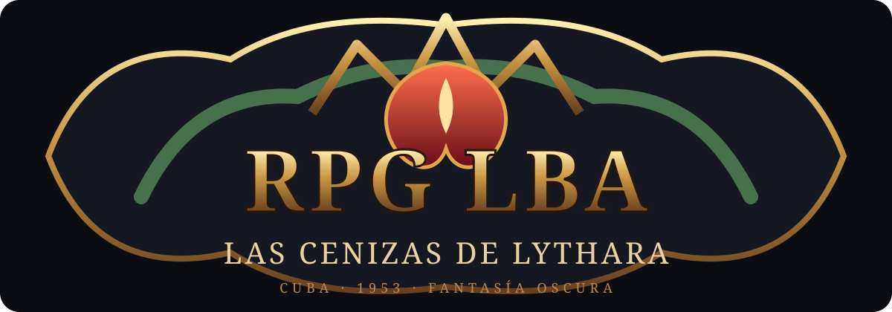
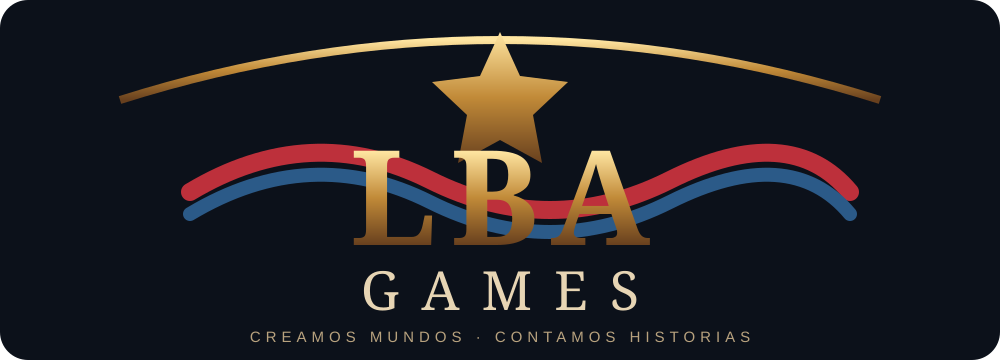

# RPG LBA — Las Cenizas de Lythara

<p align="center"></p>
<p align="center"><strong>Action RPG isométrico de fantasía oscura caribeña.</strong><br>Cuba ficticia, 1953 · Una isla viva. Un mal antiguo. Una historia que todavía no termina.</p>
<p align="center"></p>

## Visión

**RPG LBA — Las Cenizas de Lythara** es un action RPG 3D para PC y Android, desarrollado con Godot 4.7.2 Standard y GDScript. Su primera campaña, **El Eco de Valdeluz**, reimagina una Cuba ficticia de 1953 como un mundo de fantasía oscura gótico-caribeña: pueblos de portal, La Habana, centrales azucareros, mogotes, ciénagas, fortalezas, trenes y una dimensión sobrenatural.

La cultura cubana define la geografía, arquitectura, música original, oficios, vida cotidiana, personajes y memoria del mundo. La ficción sobrenatural no pretende sustituir ni falsear la historia real de Cuba.

## Identidad de juego

- Cámara elevada/isométrica y combate de acción.
- Seis clases originales con roles, recursos y debilidades distintas.
- Campaña cinematográfica por capítulos, misiones principales y cadenas secundarias.
- Exploración, mazmorras, jefes por fases, equipo y progresión.
- Mundo expansible: el primer arco concluye con una victoria parcial y deja nuevas puertas, regiones y misterios.
- Estética oscura con vegetación tropical, tierra roja, piedra caliza, hierro envejecido, cielo, ciclo día/noche y clima.
- Referencia de calidad: legibilidad y atmósfera de ARPG oscuros modernos; no se copia ninguna IP.

## Clases

| Clase | Fantasía y rol | Fortaleza | Debilidad |
|---|---|---|---|
| Machetero de la Sierra | Guardián cuerpo a cuerpo | Resistencia e interrupción | Poco alcance y movilidad |
| Bruja de la Manigua | Hechicera de control | Zonas y control de masas | Frágil al ser alcanzada |
| Sepulturero de Guanabacoa | Invocador de ecos | Invocaciones y desgaste | Requiere preparación |
| Tirador del Malecón | Tirador de precisión | Alcance y ejecución | Sufre si lo rodean |
| Cimarrón Sombrío | Duelista furtivo | Movilidad y daño explosivo | Frágil en peleas largas |
| Bardo del Solar | Apoyo rítmico | Mejora y control de grupo | Daño individual moderado |

Los atributos, poderes, especializaciones, XP, curva de niveles y pruebas de balance están en [Clases y progresión](docs/diseno/02_CLASES_ATRIBUTOS_HABILIDADES.md).

## Historia y diseño

- [Biblia narrativa y continuidad abierta](docs/narrativa/00_BIBLIA_DEL_MUNDO_Y_HISTORIA.md)
- [Misiones principales, secundarias y ganchos de expansión](docs/narrativa/01_MISIONES_Y_CADENAS.md)
- [Clases, estadísticas, habilidades y balance](docs/diseno/02_CLASES_ATRIBUTOS_HABILIDADES.md)
- [Dirección artística y UX](docs/direccion-artistica/03_DIRECCION_ARTISTICA_Y_UX.md)
- [Briefing para agentes de IA](docs/AGENT_BRIEFING_VISION_CUBANA.md)
- [Roadmap y prompts](docs/09_ROADMAP_Y_PROMPTS.md)

## Estado real (reconciliado 18-11-2026)

**Main auditado:** `e1d415b`. Las seis checks requeridas de CI reportan PASS en ese SHA. La Fase oficial 2 sigue EN CURSO: hay 3 de 6 clases implementadas (Machetero, Bruja y Sepulturero). Tirador, Cimarrón y Bardo están pendientes. La Fase 5 oficial (mundo) también es parcial: Valdeluz tiene una slice; la capital procedural está en la PR #15, abierta y en borrador, no integrada.

El APK Android se exporta y verifica en CI, con pruebas en emuladores; eso no certifica FPS sostenidos, temperatura, batería ni multitouch en teléfonos físicos. El multijugador disponible es lobby/smoke LAN, no servidor autoritativo. El inventario ARPG, la campaña completa y las regiones/dungeons restantes aún requieren implementación.

Consulta el [estado detallado](docs/STATUS.md), [roadmap oficial](docs/ROADMAP.md), [plan maestro y checklist Android](docs/PROJECT_MASTER_PLAN_2026.md), [cierre de las seis clases](docs/PHASE_2_CLASS_COMPLETION.md), [pipeline del mundo](docs/WORLD_PRODUCTION_PIPELINE.md) y [playbook de agentes](prompts/11_RPG_LBA_AGENT_PLAYBOOK.md).

## Tecnología

- Godot 4.7.2 Standard + GDScript.
- Compatibility Renderer.
- GdUnit4 y GitHub Actions.
- Objetivo Android ARM64 y PC; compatibilidad y rendimiento solo se publican tras pruebas físicas.

## Empezar

### Requisitos
Godot 4.7.2 Standard, Git y herramientas de CI descritas en el repositorio.

### Clonar e importar
```bash
git clone https://github.com/Lean031110/RPG-LBA.git
cd RPG-LBA
godot --headless --path . --import
godot --headless --editor --path . --quit
```

Abre el proyecto en Godot y ejecuta F5. Consulta `AGENTS.md`, `scripts/ci/` y `.github/workflows/` para las pruebas exactas.

## Instrucciones para agentes de IA

1. Leer `AGENTS.md` completo.
2. Leer `docs/AGENT_BRIEFING_VISION_CUBANA.md`.
3. Leer GDD, biblia, misiones, clases y dirección artística.
4. Verificar branch, commit, árbol, PR y Actions reales antes de editar.
5. Crear rama `agent/<fase>-<tarea>`; nunca push directo a `main`.
6. Trabajar una fase por PR, preservar sistemas y añadir pruebas.
7. Reportar PASS / FAIL / SKIPPED / NOT TESTED con comandos y evidencia.
8. No inventar FPS, compatibilidad Android, APK ni resultados.
9. No almacenar tokens ni secretos en archivos, logs, URLs o commits.
10. Mantener narrativa y datos ampliables: IDs estables, flags, prerequisitos y migraciones.

## Estructura

- `assets/branding/` — logos SVG.
- `assets/` — recursos con licencias y manifest.
- `ART_DEPARTMENT/` — fábrica de assets, catálogo, validación, previews y capa cloud (`CLOUD_AUTOMATION/`).
- `automation/n8n/` — plantillas de workflow n8n saneadas e inactivas.
- `automation/kaggle/` — carril GPU reanudable TripoSR-on-Kaggle (NOT TESTED).
- `firebase/` — reglas Firestore deny-by-default y guía del plan Spark opcional.
- `docs/narrativa/` — historia, regiones, personajes y misiones.
- `docs/diseno/` — clases, estadísticas, habilidades y balance.
- `docs/direccion-artistica/` — arte, iluminación, terreno y UX.
- `docs/` — GDD, arquitectura, QA y guía de agentes.
- `prompts/` — prompts por fase.
- `config/` — datos y perfiles.
- `scenes/`, `scripts/`, `tests/` — proyecto Godot.

## Producción de assets y automatización cloud — Asset Factory

La biblioteca visual y las automatizaciones tienen una guía central en [ART_DEPARTMENT/CLOUD_AUTOMATION](ART_DEPARTMENT/CLOUD_AUTOMATION/README.md). El repositorio ya incluye una fábrica procedural, catálogo y validación; no se debe crear una segunda fábrica ni asumir que los modelos de entorno equivalen a personajes finales. GitHub Actions es el orquestador cloud principal; los workflows n8n se versionan como JSON saneado e inactivo en `automation/n8n/workflows/` y nunca se guardan credenciales, tokens, claves de cifrado, bases de datos ni backups privados en este repositorio público.

### Inventario, catálogo y estado

- [Auditoría del inventario y huecos visuales](ART_DEPARTMENT/CLOUD_AUTOMATION/PRODUCTION_AUDIT.md) — 93 entradas de fábrica + 64 archivos heredados indexados
- [Índice enlazado de la biblioteca (schema 2.0.0, hashes y URLs)](ART_DEPARTMENT/CLOUD_AUTOMATION/ASSET_LIBRARY_INDEX.json) — 157 registros / 262 archivos
- [Índice de archivos heredados con IDs LEGACY estables](ART_DEPARTMENT/CLOUD_AUTOMATION/LEGACY_ASSET_INDEX.json)
- [Backlog de assets faltantes (clases, NPCs, enemigos, jefes, armas, kits)](ART_DEPARTMENT/CLOUD_AUTOMATION/ASSET_GAP_BACKLOG.json)
- [Procedencia y licencias de archivos de terceros](assets/manifest.csv) — `close.svg` sigue en cuarentena hasta verificación
- [Reconciliación PR #18/#19 (una sola fábrica, un solo catálogo)](ART_DEPARTMENT/CLOUD_AUTOMATION/PR19_RECONCILIATION.md)
- [Estado de producción del primer lote](ART_DEPARTMENT/DOCUMENTATION/PRODUCTION_STATUS.md)

### Convenciones y estructura

- [Taxonomía, IDs estables, naming y dónde va cada clase/NPC/enemigo/jefe/arma/kit](ART_DEPARTMENT/CLOUD_AUTOMATION/ASSET_CONVENTIONS.md)
- [Presupuestos móviles (triángulos, texturas, colisiones, LOD)](ART_DEPARTMENT/CLOUD_AUTOMATION/ASSET_CONVENTIONS.md#4-presupuestos-móviles-límites-de-revisión-no-aceptación)

### Generación, validación y aprobación

- [Guía de generación procedural de la fábrica](ART_DEPARTMENT/DOCUMENTATION/GENERATION_GUIDE.md)
- [Flujo de aprobación (PR humano, sin auto-merge)](ART_DEPARTMENT/CLOUD_AUTOMATION/README.md#11-asset-approval-workflow)
- [Validador consolidado de la fábrica (CI)](scripts/ci/validate_asset_factory.py) — se ejecuta en [asset-library-index.yml](.github/workflows/asset-library-index.yml)
- [Compatibilidad Godot del arte](ART_DEPARTMENT/DOCUMENTATION/GODOT_COMPATIBILITY.md) e [integración en escenas](ART_DEPARTMENT/DOCUMENTATION/ASSET_INTEGRATION.md)
- [Evidencia real: Blender headless y Godot 4.7.2 import](ART_DEPARTMENT/CLOUD_AUTOMATION/EVIDENCE)

### Proveedores, coste cero y GPU

- [Registro de proveedores, licencias y cuotas (27, esquema 1.1.0)](ART_DEPARTMENT/CLOUD_AUTOMATION/PROVIDER_REGISTRY.json)
- [Prototipo GPU reanudable TripoSR-on-Kaggle](automation/kaggle/README.md) — estado NOT TESTED hasta que existan secrets Kaggle
- [Reglas de Actions y seguridad de ramas](ART_DEPARTMENT/CLOUD_AUTOMATION/README.md#7-github-actions-safety)

### Operación y configuración

- [Secrets de GitHub (Telegram, Kaggle, Smithsonian, Firebase…)](ART_DEPARTMENT/CLOUD_AUTOMATION/SECRETS_SETUP.md) — el propietario introduce los valores en GitHub Settings, nunca por chat
- [Bot de Telegram (aviso de revisión; sin secrets = SKIPPED)](ART_DEPARTMENT/CLOUD_AUTOMATION/SECRETS_SETUP.md#crear-el-bot-de-telegram-sin-exponer-el-token)
- [Firebase opcional sin billing (reglas deny-by-default)](firebase/README.md) y [firestore.rules](firebase/firestore.rules)
- [n8n: portabilidad, export/import y restauración](ART_DEPARTMENT/CLOUD_AUTOMATION/N8N_PORTABILITY.md)
- [Troubleshooting del pipeline de arte](ART_DEPARTMENT/DOCUMENTATION/TROUBLESHOOTING.md)

### Workflows disponibles (todos publican solo en `agent/*`; nunca `main`)

| Workflow | Función |
|---|---|
| [asset-factory.yml](.github/workflows/asset-factory.yml) | Producción por lotes reanudable (guarda de rama incluida) |
| [asset-factory-scheduler.yml](.github/workflows/asset-factory-scheduler.yml) | Dispatcher seguro: valida `^(agent|feature)/` antes de despachar; cron desactivado hasta prueba e2e |
| [asset-validation.yml](.github/workflows/asset-validation.yml) | Validación de catálogo + humo Blender (bpy opcional, SKIPPED honesto) |
| [asset-library-index.yml](.github/workflows/asset-library-index.yml) | Chequeo estricto del índice 2.0.0 + validador consolidado |
| [asset-publication.yml](.github/workflows/asset-publication.yml) | Marca `published` y abre/actualiza PR (sin auto-merge) |
| [asset-review-telegram.yml](.github/workflows/asset-review-telegram.yml) | Avisos Telegram de revisión (SKIPPED sin secrets) |
| [asset-gpu-triposr.yml](.github/workflows/asset-gpu-triposr.yml) | Carril GPU Kaggle/TripoSR (idempotente, DEFERRED_QUOTA) |

El estado de producción y los enlaces deben actualizarse en cada PR de assets.

## Marca y licencias

**Juego:** RPG LBA — Las Cenizas de Lythara.  
**Campaña:** El Eco de Valdeluz.  
**Estudio:** LBA Games.

El código y los recursos pueden tener licencias distintas. Cada asset externo debe figurar en `assets/manifest.csv` con autor, URL, versión, licencia y atribución. No incorporar contenido sin licencia verificable. No copiar personajes, mapas, UI, música, iconos o textos de otros juegos.

## Contribuir

Lee `AGENTS.md`, trabaja en una rama y abre PR. Cambios visuales incluyen capturas reales 16:9 y 20:9. Cambios de gameplay incluyen pruebas unitarias e integración. No hacer merge automático.
