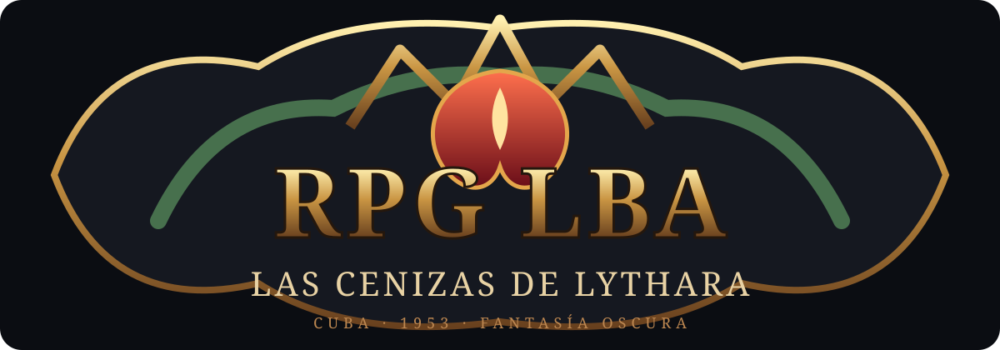
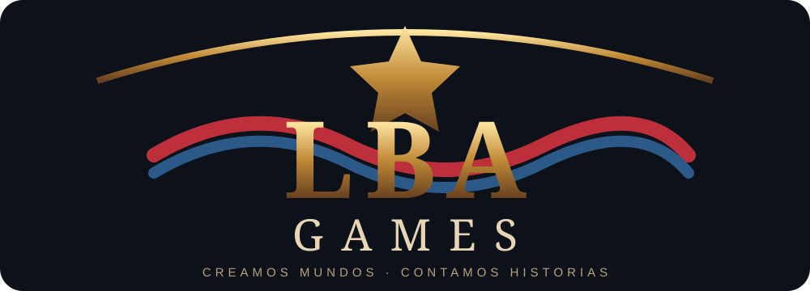

# RPG LBA — Las Cenizas de Lythara

<p align="center"></p>
<p align="center"><strong>Action RPG isométrico de fantasía oscura caribeña.</strong><br>Cuba ficticia, 1953 · Una isla viva. Un mal antiguo. Una historia que todavía no termina.</p>
<p align="center"></p>

## Visión

**RPG LBA — Las Cenizas de Lythara** es un action RPG 3D para PC y Android, desarrollado con Godot 4.7.2 Standard y GDScript. Su primera campaña, **El Eco de Valdeluz**, reimagina una Cuba ficticia de 1953 como un mundo de fantasía oscura gótico-caribeña: pueblos de portal, La Habana, centrales azucareros, mogotes, ciénagas, fortalezas, trenes y una dimensión sobrenatural.

La cultura cubana define la geografía, arquitectura, música original, oficios, vida cotidiana, personajes y memoria del mundo. La ficción sobrenatural no pretende sustituir ni falsear la historia real de Cuba.

## Identidad de juego

- Cámara elevada/isométrica y combate de acción.
- Seis clases originales con roles, recursos y debilidades distintas.
- Campaña cinematográfica por capítulos, misiones principales y cadenas secundarias.
- Exploración, mazmorras, jefes por fases, equipo y progresión.
- Mundo expansible: el primer arco concluye con una victoria parcial y deja nuevas puertas, regiones y misterios.
- Estética oscura con vegetación tropical, tierra roja, piedra caliza, hierro envejecido, cielo, ciclo día/noche y clima.
- Referencia de calidad: legibilidad y atmósfera de ARPG oscuros modernos; no se copia ninguna IP.

## Clases

| Clase | Fantasía y rol | Fortaleza | Debilidad |
|---|---|---|---|
| Machetero de la Sierra | Guardián cuerpo a cuerpo | Resistencia e interrupción | Poco alcance y movilidad |
| Bruja de la Manigua | Hechicera de control | Zonas y control de masas | Frágil al ser alcanzada |
| Sepulturero de Guanabacoa | Invocador de ecos | Invocaciones y desgaste | Requiere preparación |
| Tirador del Malecón | Tirador de precisión | Alcance y ejecución | Sufre si lo rodean |
| Cimarrón Sombrío | Duelista furtivo | Movilidad y daño explosivo | Frágil en peleas largas |
| Bardo del Solar | Apoyo rítmico | Mejora y control de grupo | Daño individual moderado |

Los atributos, poderes, especializaciones, XP, curva de niveles y pruebas de balance están en [Clases y progresión](docs/diseno/02_CLASES_ATRIBUTOS_HABILIDADES.md).

## Historia y diseño

- [Biblia narrativa y continuidad abierta](docs/narrativa/00_BIBLIA_DEL_MUNDO_Y_HISTORIA.md)
- [Misiones principales, secundarias y ganchos de expansión](docs/narrativa/01_MISIONES_Y_CADENAS.md)
- [Clases, estadísticas, habilidades y balance](docs/diseno/02_CLASES_ATRIBUTOS_HABILIDADES.md)
- [Dirección artística y UX](docs/direccion-artistica/03_DIRECCION_ARTISTICA_Y_UX.md)
- [Briefing para agentes de IA](docs/AGENT_BRIEFING_VISION_CUBANA.md)
- [Roadmap y prompts](docs/09_ROADMAP_Y_PROMPTS.md)

## Estado real

**No confundir diseño documentado con funcionalidades implementadas.** La Fase 1 fue reportada como entrega local con 48/48 pruebas y 10 capturas, pero su integración debe verificarse en GitHub. El Art Pass, las seis clases completas, la curva XP y las nuevas misiones están diseñados/documentados; no se consideran implementados hasta que existan código, pruebas y evidencia.

| Área | Estado |
|---|---|
| Godot 4.7.2 y auditoría inicial | Fase 0 reportada |
| Vertical slice | Reconstruida y publicada en `agent/fase1-vertical-slice` (PR pendiente de revisión; 108/108 pruebas GdUnit4 y CI en verde) |
| Prototipo de movimiento y controles | Fase 2 del propietario implementada en `feature/phase-2-playable-prototype` (PR pendiente; 132/132 pruebas; export Android debug verificada, dispositivo NO PROBADO) |
| HUD móvil (arco Diablo/MLBB), minimapa, correr/caminar e inventario de armas | Preparativos Fase 3 en `agent/fase3-preparativos-hud-minimap` (PR pendiente; 170/170 pruebas; capturas reales en `screenshots/arpg/`) |
| Dirección creativa y narrativa | Documentadas |
| Clases, XP y balance | Diseño revisado; implementación y simulación pendientes |
| Art Pass / ciclo día-noche / UX | Especificados; implementación pendiente |
| Campaña y cadenas secundarias | Diseño inicial documentado; contenido ampliable |
| Multijugador autoritativo | Planificado; no declarar completo |
| APK, Android físico y FPS | NOT TESTED hasta evidencia real |

## Tecnología

- Godot 4.7.2 Standard + GDScript.
- Compatibility Renderer.
- GdUnit4 y GitHub Actions.
- Objetivo Android ARM64 y PC; compatibilidad y rendimiento solo se publican tras pruebas físicas.

## Empezar

### Requisitos
Godot 4.7.2 Standard, Git y herramientas de CI descritas en el repositorio.

### Clonar e importar
```bash
git clone https://github.com/Lean031110/RPG-LBA.git
cd RPG-LBA
godot --headless --path . --import
godot --headless --editor --path . --quit
```

Abre el proyecto en Godot y ejecuta F5. Consulta `AGENTS.md`, `scripts/ci/` y `.github/workflows/` para las pruebas exactas.

## Instrucciones para agentes de IA

1. Leer `AGENTS.md` completo.
2. Leer `docs/AGENT_BRIEFING_VISION_CUBANA.md`.
3. Leer GDD, biblia, misiones, clases y dirección artística.
4. Verificar branch, commit, árbol, PR y Actions reales antes de editar.
5. Crear rama `agent/<fase>-<tarea>`; nunca push directo a `main`.
6. Trabajar una fase por PR, preservar sistemas y añadir pruebas.
7. Reportar PASS / FAIL / SKIPPED / NOT TESTED con comandos y evidencia.
8. No inventar FPS, compatibilidad Android, APK ni resultados.
9. No almacenar tokens ni secretos en archivos, logs, URLs o commits.
10. Mantener narrativa y datos ampliables: IDs estables, flags, prerequisitos y migraciones.

## Estructura

- `assets/branding/` — logos SVG.
- `assets/` — recursos con licencias y manifest.
- `docs/narrativa/` — historia, regiones, personajes y misiones.
- `docs/diseno/` — clases, estadísticas, habilidades y balance.
- `docs/direccion-artistica/` — arte, iluminación, terreno y UX.
- `docs/` — GDD, arquitectura, QA y guía de agentes.
- `prompts/` — prompts por fase.
- `config/` — datos y perfiles.
- `scenes/`, `scripts/`, `tests/` — proyecto Godot.

## Marca y licencias

**Juego:** RPG LBA — Las Cenizas de Lythara.  
**Campaña:** El Eco de Valdeluz.  
**Estudio:** LBA Games.

El código y los recursos pueden tener licencias distintas. Cada asset externo debe figurar en `assets/manifest.csv` con autor, URL, versión, licencia y atribución. No incorporar contenido sin licencia verificable. No copiar personajes, mapas, UI, música, iconos o textos de otros juegos.

## Contribuir

Lee `AGENTS.md`, trabaja en una rama y abre PR. Cambios visuales incluyen capturas reales 16:9 y 20:9. Cambios de gameplay incluyen pruebas unitarias e integración. No hacer merge automático.
